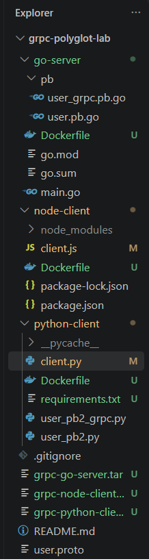

# gRPC Polyglot: Go, Python, dan Node.js

## Deskripsi Proyek

Proyek ini merupakan implementasi komunikasi inter-service menggunakan **gRPC (Google Remote Procedure Call)** dengan pendekatan Polyglot, yaitu penggunaan beberapa bahasa pemrograman dalam satu sistem.

Pada proyek ini:

- **Go** digunakan sebagai gRPC Server.
- **Python** digunakan sebagai gRPC Client.
- **Node.js** digunakan sebagai gRPC Client.
- **Protocol Buffers** digunakan sebagai kontrak komunikasi antara server dan client.
- **Docker** digunakan untuk melakukan containerization aplikasi.

Go Server menyediakan layanan `UserService` dengan method `GetUserProfile` yang mengirimkan data pengguna berupa nama, email, dan nomor telepon.

## Struktur Folder Proyek

<p align="center">
  
</p>

<p align="center"><em>Gambar 1. Struktur folder proyek</em></p>

## Teknologi yang Digunakan

1. Go
2. Python
3. Node.js
4. gRPC
5. Protocol Buffers (`protoc`)
6. Git dan GitHub
7. Docker dan Docker Desktop

## 1. Persiapan Lingkungan

Pastikan perangkat lunak berikut telah terpasang:

- Go
- Python
- Node.js dan npm
- Protocol Buffers Compiler (`protoc`)
- Git
- Docker Desktop

Periksa instalasi melalui terminal PowerShell:

```powershell
go version
python --version
node --version
npm --version
protoc --version
git --version
docker --version
```

Buka folder proyek melalui Visual Studio Code atau terminal:

```powershell
cd "D:\semester 5\Paradigma Sistem untuk IT\grpc-polyglot-lab"
```

## 2. Menjalankan Go Server

Buka terminal PowerShell dan masuk ke folder Go Server:

```powershell
cd go-server
```

Jalankan server:

```powershell
go run main.go
```

Go Server berjalan pada port `50051`.

Biarkan terminal server tetap aktif selama pengujian client secara lokal.

## 3. Menjalankan Python Client

Buka terminal PowerShell baru dari folder utama proyek:

```powershell
cd "D:\semester 5\Paradigma Sistem untuk IT\grpc-polyglot-lab\python-client"
```

Jalankan Python Client:

```powershell
python client.py
```

Client akan mengirimkan permintaan kepada Go Server dan menampilkan respons berupa nama, email, dan nomor telepon pengguna.

## 4. Menjalankan Node.js Client

Buka terminal PowerShell baru dari folder utama proyek:

```powershell
cd "D:\semester 5\Paradigma Sistem untuk IT\grpc-polyglot-lab\node-client"
```

Jalankan Node.js Client:

```powershell
node client.js
```

Node.js Client akan mengirimkan permintaan kepada Go Server dan menampilkan data pengguna dari respons server.

## 5. Mengunggah Proyek ke GitHub

Jalankan perintah berikut dari folder utama proyek.

Inisialisasi Git:

```powershell
git init
```

Periksa perubahan file:

```powershell
git status
```

Tambahkan file proyek:

```powershell
git add .
```

Buat commit:

```powershell
git commit -m "Implementasi gRPC Polyglot"
```

Atur branch utama:

```powershell
git branch -M main
```

Hubungkan dengan repositori GitHub:

```powershell
git remote add origin https://github.com/cutnaisa30-create/grpc-polyglot-lab.git
```


Unggah proyek:

```powershell
git push -u origin main
```

## 6. Membuat Docker Image Go Server

Pastikan terminal berada pada folder utama proyek.

Jalankan perintah:

```powershell
docker build -t grpc-go-server ./go-server
```

Perintah tersebut digunakan untuk membangun Docker image Go Server dengan nama `grpc-go-server`.

## 7. Membuat Docker Image Python Client

Jalankan perintah:

```powershell
docker build -t grpc-python-client ./python-client
```

Perintah tersebut digunakan untuk membangun Docker image Python Client dengan nama `grpc-python-client`.

## 8. Membuat Docker Image Node.js Client

Jalankan perintah:

```powershell
docker build -f node-client/Dockerfile -t grpc-node-client .
```

Perintah tersebut digunakan untuk membangun Docker image Node.js Client dengan nama `grpc-node-client`.

## 9. Menjalankan Aplikasi Menggunakan Docker

### 9.1 Membuat Docker Network

Buat jaringan Docker agar container dapat saling berkomunikasi:

```powershell
docker network create grpc-network
```

### 9.2 Menjalankan Go Server

Jalankan Go Server sebagai container:

```powershell
docker run -d --name grpc-go-server --network grpc-network -p 50051:50051 grpc-go-server
```

### 9.3 Memeriksa Container

Pastikan container Go Server berjalan:

```powershell
docker ps
```

### 9.4 Menguji Python Client

Jalankan Python Client melalui Docker:

```powershell
docker run --rm --network grpc-network -e GRPC_SERVER=grpc-go-server:50051 grpc-python-client
```

### 9.5 Menguji Node.js Client

Jalankan Node.js Client melalui Docker:

```powershell
docker run --rm --network grpc-network -e GRPC_SERVER=grpc-go-server:50051 grpc-node-client
```

Kedua client akan berkomunikasi dengan Go Server melalui jaringan internal Docker menggunakan alamat container `grpc-go-server:50051`.

## 10. Mengekspor dan Mengimpor Docker Image

### 10.1 Mengekspor Docker Image

Ekspor ketiga Docker image menjadi file `.tar`:

```powershell
docker save -o grpc-go-server.tar grpc-go-server

docker save -o grpc-python-client.tar grpc-python-client

docker save -o grpc-node-client.tar grpc-node-client
```

### 10.2 Memeriksa File Hasil Ekspor

Periksa file hasil ekspor menggunakan:

```powershell
Get-ChildItem *.tar
```

### 10.3 Mengimpor Kembali Docker Image

Impor kembali ketiga Docker image menggunakan:

```powershell
docker load -i grpc-go-server.tar

docker load -i grpc-python-client.tar

docker load -i grpc-node-client.tar
```

Periksa kembali daftar Docker image:

```powershell
docker images
```

## Hasil Praktikum

Berdasarkan pengujian yang telah dilakukan:

1. Go Server berhasil berjalan pada port `50051`.
2. Python Client berhasil berkomunikasi dengan Go Server.
3. Node.js Client berhasil berkomunikasi dengan Go Server.
4. Data pengguna berupa nama, email, dan nomor telepon berhasil diterima oleh kedua client.
5. Docker image Go Server, Python Client, dan Node.js Client berhasil dibuat.
6. Ketiga container berhasil menggunakan Docker Network untuk melakukan komunikasi.
7. Pengujian komunikasi Python dan Node.js Client melalui Docker berhasil dilakukan.
8. Proses ekspor dan impor Docker image menggunakan `docker save` dan `docker load` berhasil dilakukan.

## Kesimpulan

Proyek ini menunjukkan bahwa komunikasi antarbahasa pemrograman dapat diterapkan menggunakan gRPC dan Protocol Buffers. Go Server berhasil melayani permintaan dari Python Client dan Node.js Client. Selain itu, penerapan Docker memungkinkan aplikasi dijalankan dalam container dan saling berkomunikasi melalui Docker Network. Dengan demikian, implementasi gRPC Polyglot dan containerization menggunakan Docker berhasil dilakukan.

## Perbedaan Static dan Dynamic Code Generation

Pada implementasi gRPC Polyglot ini, bahasa Go dan Python menggunakan **static code generation**, yaitu kode komunikasi gRPC dibuat terlebih dahulu dari file `user.proto` menggunakan compiler `protoc` dan plugin yang sesuai. Kode hasil generasi kemudian digunakan oleh server Go dan client Python.

Sementara itu, Node.js menggunakan **dynamic runtime generation** melalui library `@grpc/proto-loader`, yang membaca file `user.proto` saat aplikasi dijalankan. Dengan demikian, Node.js tidak memerlukan proses generasi kode secara terpisah.

Kedua pendekatan tersebut memungkinkan aplikasi yang menggunakan bahasa pemrograman berbeda untuk berkomunikasi melalui kontrak data gRPC yang sama.